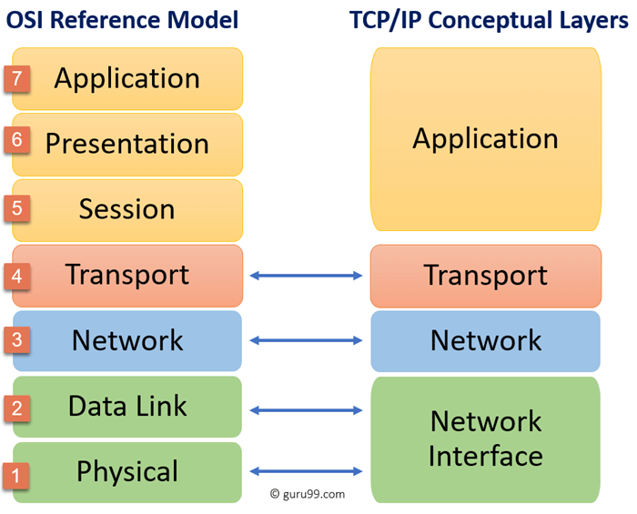

# Networking Fundamentals

## 1. OSI Model and TCP/IP Model

Network communication is easier to understand when it is divided into layers. Each layer has a specific role. Two common models are the **OSI model** and the **TCP/IP model**.



### 1.1 Comparison of OSI and TCP/IP

| OSI Model | TCP/IP Model | Main purpose |
|---|---|---|
| Application (Layer 7) | Application | Provides network services to applications. |
| Presentation (Layer 6) | Application | Translates, encrypts and compresses data. |
| Session (Layer 5) | Application | Starts, manages and ends communication sessions. |
| Transport (Layer 4) | Transport | Provides process-to-process data delivery. |
| Network (Layer 3) | Internet | Handles logical addressing and routing. |
| Data Link (Layer 2) | Network Access / Link | Transfers frames over a local network. |
| Physical (Layer 1) | Network Access / Link | Sends raw bits through a physical medium. |

### 1.2 Key Differences

- **OSI** has 7 layers. **TCP/IP** commonly has 4 layers.
- OSI is a reference model. It helps explain how network communication works.
- TCP/IP is a practical model based on the protocols used on the internet.
- The OSI model separates the Session, Presentation and Application layers. TCP/IP groups these functions into its Application layer.
- The OSI Physical and Data Link layers are grouped into the TCP/IP Network Access layer. This layer is also called the Link layer.
- Both models describe how data moves from one device to another.

## 2. The Seven Layers of the OSI Model

The **OSI (Open Systems Interconnection) model** has seven layers. Each layer performs a different task. Together, they describe how data travels across a network.

### 2.1 Layer 7: Application Layer

The Application layer gives the interface between humanand data network. It provides network services to applications. PDU: Data.

**Main functions:**
- Provides services for web browsing, email, file transfer and other network applications.
- Allows applications to request network communication.
- Uses protocols such as HTTP, HTTPS, FTP, DNS and SMTP.

### 2.2 Layer 6: Presentation Layer

The Presentation layer prepares data for the Application layer. It makes sure that data is in a usable format.

**Main functions:**
- Translates data between different formats.
- Encrypts and decrypts data.
- Compresses and decompresses data.
- No particular protocol stack

### 2.3 Layer 5: Session Layer

The Session layer manages communication sessions between applications on different devices. It is responsible for dialog control & synchronization.

**Main functions:**
- Starts and establishes sessions.
- Keeps sessions active and manages communication during them.
- Ends sessions when communication is complete.
- Can help with session recovery and synchronization.

### 2.4 Layer 4: Transport Layer

The Transport layer provides communication between one processes to another. It breaks data into smaller pieces and manages their delivery. PDU: **Segment**

**Main functions:**
- Divides data into segments.
- Uses 16 bit port numbers to identify applications or services.
- Provides connection control, flow control and  error recovery when required.
- Error recovery - retransmission
- Common Protocols: TCP and UDP.

### 2.5 Layer 3: Network Layer

The Network layer delivers packets from host to destination. It determines how data should travel toward its destination. PDU: **Packet**

**Main functions:**
- Uses logical addresses such as IP addresses (32 bit).
- Selects routes for packets - Routing.
- Forwards packets between networks through routers.
- Supports IP and routing protocols.

### 2.6 Layer 2: Data Link Layer

The Data Link layer transfers data between opne hop to another. PDU: **Frames**.

**Main functions:**
- Creates and handles frames.
- Uses physical MAC addresses (48 bits) for local delivery.
- Controls access to the network medium.
- Detects some transmission errors - correction and retransmission.
- Is commonly associated with Ethernet and Wi-Fi link functions.

### 2.7 Layer 1: Physical Layer

The Physical layer sends raw bits through a physical or wireless medium. It deals with the hardware and signal transmission.

**Main functions:**
- Transmits and receives bits.
- Defines electrical, radio or optical signals.
- Specifies cables, connectors, frequencies and data rates.
- Describes the physical connection between devices.

# HTTP, Cookies, Web Caching, Proxy Servers, CDNs and HTTPS

## 1. What Is HTTP?

**HTTP (Hypertext Transfer Protocol)** is an application-layer protocol. It defines how a client and a server communicate on the Web.

A client is usually a web browser. A server stores or creates resources such as HTML pages, images, videos and API data.

HTTP follows a **request-response model**:

1. The client sends an HTTP request.
2. The server processes the request.
3. The server sends an HTTP response.
4. The browser processes the response and displays or uses the returned data.

HTTP is **stateless**. The protocol does not automatically remember what happened in a previous request. Cookies and other application mechanisms are used when a website needs to remember a user or a session. It is an application-layer protocol which commonly uses **TCP** as its transport with HTTP/1.1 and HTTP/2. HTTP/3 uses QUIC which runs over **UDP**. **HTTPS** means HTTP communication protected by TLS.

---

## 2. Understanding a Web URL

A **URL identifies where a resource can be found and how it should be accessed.

for xample:

```text
https://www.robendevs.com:443/products/laptop.html?color=black#reviews
```

The URL contains several parts.

### 2.1 URL Parts

| Part | Example | Meaning |
|---|---|---|
| Scheme / protocol | `https` | Tells the browser which protocol to use. |
| Subdomain | `www` | A name used under the main domain. It is optional. |
| Domain name | `robendevs.com` | The registered domain name in this example. |
| Top-level domain (TLD) | `.com` | The final domain label. |
| Hostname | `www.robendevs.com` | The complete DNS name used to identify the host. |
| Port | `443` | The network port used by the service. |
| Path | `/products/laptop.html` | Identifies the resource or route on the server. |
| File-like name | `laptop.html` | The final path segment. It looks like a file name. |
| Query string | `?color=black` | Sends optional parameters to the server. |
| Fragment | `#reviews` | Points to a section or location within the resource. |

### 2.2 Scheme or Protocol

The scheme is the part before `://`.

Examples:

- `http://` uses HTTP without TLS encryption.
- `https://` uses HTTP protected by TLS.
- `ftp://` is associated with the File Transfer Protocol.

For normal web browsing, the default port is usually `80` for HTTP and `443` for HTTPS. A URL can specify another port explicitly.

---

## 3. HTTP Message Types

HTTP communication uses two main message types:

1. **HTTP Request Message** — sent by a client to a server.
2. **HTTP Response Message** — sent by a server to a client.

## 4. HTTP Request Message

An HTTP request tells the server what resource the client wants and what action it wants to perform.

### 4.1 Request Message Format

A simplified HTTP/1.1 request has this structure:

```text
METHOD /path HTTP/version
Header-Name: header value
Another-Header: another value

Optional request body
```

It contains four main parts:

1. **Request line** — contains the method, request target and HTTP version.
2. **Headers** — provide extra information about the request, client, accepted formats, authentication and other details.
3. **Blank line** — separates the headers from the message body.
4. **Message body** — optional data sent to the server.

### 4.2 Request Example: GET

```http
GET /products/42 HTTP/1.1
Host: www.robendevs.com
User-Agent: Mozilla/5.0
Accept: text/html
Accept-Language: en-US,en;q=0.9
Connection: keep-alive

```

Explanation:

- `GET` is the HTTP method.
- `/products/42` is the requested path.
- `HTTP/1.1` is the HTTP version.
- `Host` identifies the requested host. HTTP/1.1 uses this header to identify the target host.
- `User-Agent` describes the client software. Its contents are not a reliable way to identify a user.
- `Accept` tells the server which response media types the client can handle.
- `Accept-Language` expresses language preferences.
- `Connection` is a connection-management header used in HTTP/1.x. Connection-specific headers are handled differently in HTTP/2 and HTTP/3.
- There is no request body in this example.

### 4.3 Request Example: POST with a Body

```http
POST /api/users HTTP/1.1
Host: api.example.com
Content-Type: application/json
Accept: application/json
Content-Length: 42

{"name":"Alex","email":"alex@robendevs.com"}
```

Explanation:

- `POST` asks the server to process the submitted data.
- `Content-Type` describes the format of the request body.
- `Content-Length` gives the body size in bytes when this framing is used.
- The JSON data is the request body.

---

## 5. HTTP Methods

An HTTP method describes the purpose of a request. Methods are also called **HTTP verbs**.

| Method | Purpose | Example use |
|---|---|---|
| `GET` | Retrieves a resource. | Load a web page or read product information. |
| `POST` | Submits data for processing. It often creates a resource or causes an action. | Submit a form or create a user. |
| `PUT` | Creates or replaces the target resource with the submitted representation. | Replace a user's profile data. |
| `PATCH` | Applies a partial update to a resource. | Change only a user's phone number. |
| `DELETE` | Requests deletion of a resource. | Delete a comment. |
| `HEAD` | Works like `GET`, but the response has no body. | Check headers or resource metadata. |
| `OPTIONS` | Asks which communication options are available. | Check allowed methods or support for a CORS request. |
| `CONNECT` | Establishes a tunnel to the target server. | Create an HTTPS tunnel through a forward proxy. |
| `TRACE` | Performs a message loop-back test. | Diagnostic use; often disabled for security reasons. |

### 5.1 Safe Methods

A method is **safe** when the client is not asking the server to change application state.

- `GET`, `HEAD`, and `OPTIONS` are safe methods.
- A safe method may still cause normal server-side logging or statistics collection.
- A website should not use `GET` to perform actions such as deleting an account or placing an order.

### 5.2 Idempotent Methods

A method is **idempotent** when repeating the same request has the same intended effect on the server as sending it once.

Examples:

- Sending the same `PUT` request several times should leave the resource in the same final state.
- Sending the same `DELETE` request several times should still leave the resource deleted.
- `GET` is also idempotent because it is not intended to change application state.
- `POST` is not generally idempotent. Repeating it may create multiple records or perform an action more than once.

Idempotency does not mean that every response must be identical. For example, a second `DELETE` request may return `404` after the first one deleted the resource.

---

## 6. HTTP Response Message

An HTTP response carries the result of the request. It may contain the requested resource, an error message, a redirect, or other information.

### 6.1 Response Message Format

A simplified HTTP/1.1 response has this structure:

```text
HTTP/version status-code reason-phrase
Header-Name: header value
Another-Header: another value

Optional response body
```

It contains four main parts:

1. **Status line** — contains the HTTP version, status code, and optional reason phrase.
2. **Headers** — provide information about the response and its content.
3. **Blank line** — separates headers from the response body.
4. **Message body** — optional returned data, such as HTML, JSON, an image, or an error message.

### 6.2 Response Example

```http
HTTP/1.1 200 OK
Date: Sun, 08 Nov 2026 00:00:00 GMT
Content-Type: text/html; charset=UTF-8
Content-Length: 46
Cache-Control: max-age=60

<html><body><h1>Hello World</h1></body></html>
```

Explanation:

- `HTTP/1.1` is the protocol version used by this example.
- `200` is the status code. It means the request succeeded.
- `OK` is the reason phrase. It is human-readable and does not control the meaning of the numeric status code.
- `Date` tells when the response was generated.
- `Content-Type` identifies the media type of the response body.
- `Content-Length` gives the body size in bytes when this framing is used.
- `Cache-Control` gives instructions to HTTP caches.
- The HTML after the blank line is the response body.

### 6.3 Another Response Example: JSON

```http
HTTP/1.1 201 Created
Content-Type: application/json
Location: /api/users/42

{"id":42,"name":"Alex"}
```

`201 Created` means the request successfully created a resource. The `Location` header identifies the new resource in this example.

---

## 7. HTTP Response Status Codes

A status code is a three-digit number. It tells the client the general result of the request.

The first digit identifies the status-code class:

| Range | Class | Meaning |
|---|---|---|
| `1xx` | Informational | The request was received. The process is continuing. |
| `2xx` | Success | The request was successfully handled. |
| `3xx` | Redirection | The client needs to take another action, often by following a redirect. |
| `4xx` | Client error | There is a problem with the request or the requested resource. |
| `5xx` | Server error | The server failed to complete an apparently valid request. |

### 7.1 Common Status Codes

#### 1xx — Informational

| Code | Meaning | Explanation |
|---|---|---|
| `100 Continue` | Continue | The client can continue sending the request body. |
| `101 Switching Protocols` | Switching Protocols | The server is switching to a protocol requested by the client. |

#### 2xx — Success

| Code | Meaning | Explanation |
|---|---|---|
| `200 OK` | OK | The request succeeded. The response usually contains the requested data. |
| `201 Created` | Created | A resource was successfully created. |
| `202 Accepted` | Accepted | The request was accepted for processing, but processing may not be complete. |
| `204 No Content` | No Content | The request succeeded, but there is no response body. |
| `206 Partial Content` | Partial Content | The server returned part of a resource, often for a download. |

#### 3xx — Redirection

| Code | Meaning | Explanation |
|---|---|---|
| `301 Moved Permanently` | Permanent redirect | The resource has a new permanent URL. |
| `302 Found` | Temporary redirect | The resource is temporarily available at another URL. |
| `303 See Other` | See Other | The client should retrieve another resource, commonly with `GET`. |
| `304 Not Modified` | Not Modified | The cached copy is still valid. The server does not need to send the resource body again. |
| `307 Temporary Redirect` | Temporary redirect | The client should follow the redirect and keep the original method. |
| `308 Permanent Redirect` | Permanent redirect | The redirect is permanent and the original method is kept. |

#### 4xx — Client Error

| Code | Meaning | Explanation |
|---|---|---|
| `400 Bad Request` | Bad Request | The request is invalid or cannot be understood. |
| `401 Unauthorized` | Unauthorized | Authentication is required or has failed. |
| `403 Forbidden` | Forbidden | The server understood the request but refuses to allow it. |
| `404 Not Found` | Not Found | The requested resource was not found. |
| `405 Method Not Allowed` | Method Not Allowed | The method is not supported for this resource. |
| `408 Request Timeout` | Request Timeout | The server did not receive the complete request in time. |
| `409 Conflict` | Conflict | The request conflicts with the current state of the resource. |
| `410 Gone` | Gone | The resource is no longer available and this may be permanent. |
| `413 Content Too Large` | Content Too Large | The request content is larger than the server is willing to process. |
| `415 Unsupported Media Type` | Unsupported Media Type | The server does not support the request body's format. |
| `422 Unprocessable Content` | Unprocessable Content | The request format is understood, but its instructions cannot be processed. |
| `429 Too Many Requests` | Too Many Requests | The client has sent too many requests in a given period. |

#### 5xx — Server Error

| Code | Meaning | Explanation |
|---|---|---|
| `500 Internal Server Error` | Internal Server Error | The server encountered an unexpected problem. |
| `501 Not Implemented` | Not Implemented | The server does not support the required functionality. |
| `502 Bad Gateway` | Bad Gateway | A gateway or proxy received an invalid response from an upstream server. |
| `503 Service Unavailable` | Service Unavailable | The server is temporarily unable to handle the request. |
| `504 Gateway Timeout` | Gateway Timeout | A gateway or proxy did not receive a timely response from an upstream server. |

The reason phrase, such as `OK` or `Not Found`, is mainly for people. The numeric status code carries the protocol meaning.

---

## 8. HTTP Cookies

### 8.1 What Is a Cookie?

A **cookie** is a small piece of data that a website asks the browser to store.

The browser may send the cookie back to the website in later requests. This allows a website to remember information between requests.

Cookies are important because HTTP is stateless. Without cookies or another state-management system, a website would not automatically know that two requests came from the same browser session.

Common uses include:

- Keeping a user logged in.
- Remembering a shopping cart.
- Saving language or theme preferences.
- Remembering consent settings.
- Measuring website usage.
- Supporting advertising and analytics.

A cookie usually contains a name and a value. It may also have attributes that control where, when, and how the browser sends it.

### 8.2 Important Cookie Terms

| Term | Meaning |
|---|---|
| Cookie | The small name-value data item and its associated attributes. |
|cookie database | The browser's internal storage for cookie records. |
| First-party cookie | A cookie associated with the site the user is visiting. |
| Third-party cookie | A cookie associated with a different site whose content is used by the current page. |
| Session cookie | A cookie without an explicit expiry time. |
| Persistent cookie | A cookie with an expiry time or lifetime. |
| Session ID | A token that a website may store in a cookie to identify a server-side session. |

### 8.3 Why Do Websites Need Cookies?

Imagine logging in to a website.

1. The browser sends the login form to the server.
2. The server checks the username and password.
3. If the login is successful, the server creates a session or another authentication record.
4. The server sends a response with a `Set-Cookie` header.
5. The browser stores the cookie if it accepts the cookie and its attributes.
6. On later matching requests, the browser sends the cookie in a `Cookie` header.
7. The server reads the session token and identifies the logged-in session.

This is how a website can recognize a user across separate HTTP requests.

A secure website normally stores an unpredictable session token in the cookie. The actual session data can remain on the server. The cookie is then a reference to that session, not the user's password.

### 8.4 How a Cookie Is Created and Sent

The server creates a cookie with the **`Set-Cookie` response header**.

Example:

```http
HTTP/1.1 200 OK
Content-Type: text/html
Set-Cookie: session_id=abc123; Path=/; Secure; HttpOnly; SameSite=Lax

```

The browser checks the cookie and its attributes. If accepted, it stores the cookie in its cookie store.

A website can also create or change cookies through JavaScript using `document.cookie`. JavaScript cannot create an `HttpOnly` cookie. It also cannot read an `HttpOnly` cookie. A server should set sensitive session cookies through the `Set-Cookie` response header so that it can apply `HttpOnly` and other security attributes.

Later, the browser may send it with a matching request:

```http
GET /account HTTP/1.1
Host: example.com
Cookie: session_id=abc123

```

Important points:

- The server uses `Set-Cookie` to ask the browser to store or update a cookie.
- The browser uses `Cookie` to send matching cookie name-value pairs to the server.
- Cookie attributes such as `Secure`, `HttpOnly` and `SameSite` are not repeated in the `Cookie` request header.
- A browser does not send every cookie to every website. It selects cookies based on their scope, security requirements, expiry and request context.
- Each cookie should normally be set with its own `Set-Cookie` response header. Do not combine multiple cookies into one comma-separated `Set-Cookie` header.
---

## 9. Web Cache

### 9.1 What Is a Web Cache?

A **web cache** stores copies of HTTP responses so they can be reused later. For example, when a browser downloads a logo image, it may store a copy. When the user visits another page that needs the same image, the browser may use the cached copy instead of downloading it again.

An HTTP cache stores response information and decides whether a stored response can be reused. Caches can exist in the browser, in a proxy, in a CDN, or in other parts of the delivery path.

### 9.2 Types of Web Cache

#### Browser Cache (Private Cache)

The browser stores resources for that browser profile or user.

Examples:

- HTML pages, depending on cache rules.
- CSS and JavaScript files.
- Images, fonts and other static resources.

Benefits:

- Faster repeat visits.
- Less data downloaded.
- Lower bandwidth usage.
- Better performance on slower connections.

A browser cache is normally private to that browser user. Other users do not share it.

#### Shared Cache

A shared cache can store a response for reuse by multiple users.

Examples include:

- A forward proxy cache in an organization.
- A reverse proxy cache in front of a website.
- A CDN edge cache.

Shared caches need careful rules. They must not accidentally return one user's private response to another user.

---

## 10. Proxy Server

### 10.1 What Is a Proxy Server?

A **proxy server** is an intermediary that receives a request from one side and forwards it to another side. The word proxy means that the server acts on behalf of another system.

There are two main types:

1. Forward proxy.
2. Reverse proxy.

### 10.2 Forward Proxy

A **forward proxy** sits between clients and external servers.

```text
Client / Browser
       |
       v
Forward Proxy
       |
       v
Internet / Website Server
```

The client sends its request to the proxy. The proxy forwards the request to the destination server and returns the response to the client.

Common uses:

- **Access control:** An organization can allow or block access to selected websites.
- **Monitoring:** An organization can record network usage according to its policies and laws.
- **Filtering:** A proxy can block unsafe or unwanted destinations.
- **Shared caching:** It can store commonly requested resources for many users.
- **Network management:** It can control how a group of clients accesses the Internet.
- **Client IP masking:** The destination server may see the proxy's IP address instead of the client's direct IP address. This does not guarantee anonymity.

For HTTPS, a forward proxy can often create a `CONNECT` tunnel. Without authorized TLS inspection, it can forward the encrypted connection but cannot read the protected HTTP contents.

### 10.3 Reverse Proxy

A **reverse proxy** sits in front of one or more origin servers.

```text
Browser / Client
       |
       v
Reverse Proxy
       |
       +------> Web Server 1
       |
       +------> Web Server 2
       |
       +------> Web Server 3
```

The client sends a request to the website. The reverse proxy receives it and forwards it to an appropriate backend server.

The client usually does not communicate directly with the origin server.

Common uses:

- **Load balancing:** Distributes requests across multiple servers.
- **Security:** Hides the origin server's network details and can filter suspicious traffic.
- **TLS termination:** Handles HTTPS connections at the proxy and forwards requests to backend servers.
- **Caching:** Stores static or suitable dynamic responses.
- **Compression:** Compresses responses to reduce transfer size.
- **Routing:** Sends requests to different backend services based on the host or path.
- **High availability:** Can route traffic to healthy servers when another server is unavailable.

### 10.4 Why Are Proxy Servers Important?

Proxy servers help organizations and websites control, protect, and manage traffic.

Forward proxies are mainly used to manage client access to external resources. Reverse proxies are mainly used to manage and protect access to backend servers.

A proxy is a general networking concept. It does not have to be a CDN.

---

## 11. CDN Server

### 11.1 What Is a CDN?

**CDN (Content Delivery Network)** is a distributed network of servers that delivers website content from locations closer to users.

A CDN usually has many **edge servers** or **points of presence (PoPs)** in different regions.

Instead of making every user download every resource from one central origin server, a CDN can serve cached resources from a nearby edge location.

### 11.2 Main CDN Components

| Component | Function |
|---|---|
| Origin server | The main server where the original website content is stored or generated. |
| Edge server | A CDN server close to users. It can serve cached content. |
| Point of Presence (PoP) | A physical or network location where CDN infrastructure is deployed. |
| Cache | Stores eligible copies of resources. |
| CDN routing system | Directs users to an appropriate edge location. |

### 11.3 How a CDN Works

A simplified CDN request flow:

1. The user opens a website that uses a CDN.
2. DNS or the CDN's routing system directs the request to an appropriate CDN edge location.
3. The edge server checks its cache.
4. If the resource is in the cache and is usable, the edge server returns it. This is a **cache hit**.
5. If the resource is missing or stale, the edge server requests it from the origin server, subject to the CDN's rules. This is a **cache miss**.
6. The edge server may store the eligible response.
7. Later users may receive the cached response from that edge location.

### 11.4 What Can a CDN Deliver?

CDNs commonly deliver:

- Images.
- CSS files.
- JavaScript files.
- Fonts.
- Videos and other media.
- Software downloads.
- Other cacheable resources.

Some CDNs also support dynamic request routing, API acceleration, security filtering, and other services. Dynamic or user-specific responses are not automatically safe to cache.

### 11.5 Why Are CDNs Important?

- **Lower latency:** Content can be delivered from a nearby edge server.
- **Faster loading:** Users may not need to contact a distant origin for every resource.
- **Less origin traffic:** The CDN handles many cacheable requests.
- **Lower bandwidth costs:** Repeated content can be served from CDN caches.
- **Scalability:** The distributed network can handle large traffic volumes.
- **Availability:** CDN infrastructure can help keep content available during some origin or traffic problems.
- **Security:** Many CDNs provide DDoS protection, web application firewall features, rate limiting, and TLS services.

A CDN does not make every request local. Cache misses and dynamic requests may still need to reach the origin server.

---

## 12. Proxy Server vs. CDN

A proxy server is a general intermediary. A CDN is a distributed content-delivery system. Many CDN providers use reverse-proxy technology at their edge locations.

| Feature | Proxy Server | CDN |
|---|---|---|
| Main purpose | Forward, filter, control, protect, or route requests. | Deliver content quickly and reliably from distributed locations. |
| Typical position | May sit in front of clients or in front of servers. | Usually sits in front of origin servers as a reverse proxy. |
| Main types | Forward proxy and reverse proxy. | A distributed set of edge servers, usually acting as reverse proxies. |
| Caching | May cache content, but caching is not required. | Caching is a major feature, but not the only feature. |
| Geographic distribution | Not required. | Usually distributed across many regions. |
| Common users | Organizations, networks, application owners, and service providers. | Websites, applications, media services, and large platforms. |
| Main benefits | Access control, privacy features, security, routing, and load management. | Lower latency, less origin load, scalability, and availability. |

### 12.1 Simple Difference

- A **forward proxy** works on behalf of clients.
- A **reverse proxy** works on behalf of servers.
- A **CDN** uses a distributed network of servers to deliver content. Its edge servers commonly behave like reverse proxies.

A CDN can therefore be considered a specialized system that often uses reverse-proxy technology. Not every proxy is a CDN.

---

## 13. HTTPS

### 13.1 What Is HTTPS?

**HTTPS (Hypertext Transfer Protocol Secure)** is HTTP communication protected by **TLS (Transport Layer Security)**.

The URL begins with `https://` when the browser uses HTTPS.

HTTP transfers application data without built-in TLS protection. HTTPS protects HTTP communication while it travels across the network.

HTTPS normally uses port `443` by default.

### 13.2 HTTP vs. HTTPS

| Feature | HTTP | HTTPS |
|---|---|---|
| Full name | Hypertext Transfer Protocol | Hypertext Transfer Protocol Secure |
| Encryption | No TLS encryption by default. | Uses TLS encryption. |
| Data integrity | No TLS integrity protection. | TLS detects unauthorized changes to protected data in transit. |
| Server authentication | Does not provide TLS certificate authentication. | Uses a server certificate to authenticate the server's domain identity. |
| Default port | `80` | `443` |
| URL scheme | `http://` | `https://` |
| Suitable for sensitive data | Not suitable without another secure protection layer. | Designed to protect data in transit. |

### 13.3 What Does HTTPS Protect?

TLS provides three important protections:

#### 1. Confidentiality

The HTTP data is encrypted. A person who captures the network traffic should not be able to read the protected content without the required keys.

This protects information such as:

- Login form data.
- Cookies sent over the HTTPS connection.
- API request and response bodies.
- HTTP headers and URL paths inside the encrypted HTTP traffic.

#### 2. Integrity

TLS detects if protected data is changed during transmission. An attacker should not be able to silently modify the protected message without detection.

#### 3. Authentication

The server presents a digital certificate. The browser checks whether the certificate is valid for the hostname and chains to a trusted Certificate Authority (CA).

This helps the browser confirm that it is communicating with a server authorized for the requested domain.

**HTTPS limitations:** HTTPS does not prove that a website is honest or free from malware. It does not protect a device that is already compromised. It also does not hide all network information. For example, the destination IP address is generally visible to the network, and DNS visibility depends on how DNS is configured.

---

## 14. SSL, TLS, and Digital Certificates

### 14.1 SSL vs. TLS

- **SSL (Secure Sockets Layer)** is an older security protocol.
- **TLS (Transport Layer Security)** is its modern successor.
- Old SSL versions are obsolete and insecure.
- Modern HTTPS uses TLS, not old SSL.

People still commonly say **SSL certificate**, but the accurate modern term is **TLS certificate** or **server certificate**.

A certificate is not the encryption algorithm itself. It helps authenticate the server's identity and public key.

### 14.2 What Is a Digital Certificate?

A digital certificate is an electronic document that connects an identity, such as a website hostname, with a public key.

A web server's certificate commonly contains:

- The website's domain names, usually in the Subject Alternative Name (SAN) field.
- The server's public key.
- The identity of the certificate issuer.
- A validity period.
- The allowed key usage and other certificate extensions.
- The Certificate Authority's digital signature.

Example:

A certificate may state that the public key belongs to `www.example.com`. A trusted CA signs the certificate so that browsers can verify the certificate's authenticity.

### 14.3 Public Key and Private Key

Public-key cryptography uses a key pair:

- **Public key:** Can be shared with others.
- **Private key:** Must remain secret and under the server owner's control.

The server certificate contains the public key. The server keeps the matching private key securely.

The private key is not sent to the browser.

In modern TLS 1.3, the certificate's public key is mainly used to verify the server's digital signature during authentication. A separate key-agreement process creates shared session secrets. The browser does not simply encrypt the full session key with the certificate's public key.

### 14.4 Certificate Authority (CA)

A **Certificate Authority** is an organization trusted to issue and sign digital certificates.

Examples of CA services include Let's Encrypt and commercial certificate providers.

A browser or operating system contains a store of trusted root CA certificates. This store is used when checking a server's certificate chain.

### 14.5 Certificate Chain of Trust

A certificate chain commonly contains three levels:

```text
Trusted Root CA Certificate
          |
          v
Intermediate CA Certificate
          |
          v
Website / Server Certificate
```

- **Root certificate:** A trust anchor included in the browser or operating system's trusted certificate store.
- **Intermediate certificate:** A certificate signed by a trusted root or another intermediate CA. It is used to issue website certificates.
- **Server certificate:** The certificate presented by the website for its hostname.

The browser checks the signatures from the server certificate through the intermediate certificates to a trusted root.

The server normally sends its certificate and the necessary intermediate certificates. The root certificate is usually already trusted by the browser or operating system.

---

## 15. How a TLS Certificate Is Issued

A simplified certificate-issuance process is:

1. The website owner creates a public/private key pair.
2. The website owner creates a **CSR (Certificate Signing Request)**. It includes the public key and the requested domain information.
3. The website owner sends the CSR to a Certificate Authority.
4. The CA verifies control of the requested domain. The exact validation method depends on the certificate and CA process.
5. The CA creates and digitally signs the certificate.
6. The website owner installs the certificate and required intermediate certificates on the server or TLS-terminating service.
7. The private key remains securely stored by the website owner or service that operates TLS.

A CA should not need the website's private key to issue a normal server certificate. The private key must remain secret.

### 15.1 Common Certificate Validation Types

- **Domain Validation (DV):** Confirms control of the domain. It is commonly used for normal websites.
- **Organization Validation (OV):** Includes checks about the organization requesting the certificate.
- **Extended Validation (EV):** Applies additional organization checks under the relevant CA rules.

These types do not mean that one HTTPS connection uses stronger encryption than another. TLS configuration determines the cryptographic protection. A certificate also does not prove that the website's business or content is trustworthy.

---

# IP Address and Port Address

## 1. What Is an IP Address?

An **IP (Internet Protocol) address** is a numerical address used to identify a device or network interface and route data across a network.

Example IPv4 address:

```text
192.0.2.10
```

When a browser contacts a website, it needs an IP address to know where to send the network packets.

**Why is an IP address important?**
- It helps identify the destination on a network.
- Routers use IP addresses to forward packets.
- DNS helps browsers find the IP address linked to a domain name.

## 2. What Is a Port Number?

A **port number** identifies a service or application running on a device.

An IP address helps find the server. A port number helps reach the correct service on that server.

Common ports:

| Port | Common use |
|---|---|
| 80 | HTTP |
| 443 | HTTPS |
| 22 | SSH |
| 53 | DNS |

Port numbers are 16-bit values, from 0 to 65535. The commonly used ranges are 0–1023 (system or well-known ports), 1024–49151 (registered ports), and 49152–65535 (dynamic or private ports). [IANA/RFC 6335](https://www.rfc-editor.org/rfc/rfc6335)

For example:

```text
https://example.com:443/products
```

- `example.com` is the hostname.
- DNS resolves the hostname to an IP address.
- `443` is the destination port for HTTPS.
- If the port is omitted, the browser normally uses the default port for the scheme: 80 for HTTP and 443 for HTTPS.

**Remember:** An IP address identifies the network destination. A port identifies the service at that destination.

## 3. How Does DNS Find the IP Address?

DNS (Domain Name System) translates a domain name into an IP address.

The main records used for this are:
- **A record:** maps a hostname to an IPv4 address.
- **AAAA record:** maps a hostname to an IPv6 address.

Example:

```text
www.example.com
       |
       | DNS lookup
       v
A record    -> 192.0.2.10
AAAA record -> 2001:db8::10
```

A domain can have more than one IP address. DNS does not normally provide the website's port in an A or AAAA record. The browser gets the port from the URL or uses the default port.

## 4. Static IP and Dynamic IP

### Static IP

A **static IP address** is intended to stay the same over time. It is configured or assigned as a stable address.

It is useful for servers and services that need a predictable address.

### Dynamic IP

A **dynamic IP address** is assigned automatically and may change over time. For example, a router or server may receive an address through DHCP.

Dynamic addresses are common for home internet connections and many networks.

### What happens if a server's IP address changes?

A website normally uses DNS, so users do not need to remember its IP address.

If the server's public IP changes:

1. Update the domain's DNS A record, or AAAA record if its IPv6 address changed.
2. Wait for DNS caches to refresh according to the record's TTL (Time to Live).
3. After caches refresh, clients will use the new address.

Some users may temporarily reach the old address because DNS answers can remain cached until their TTL expires.

A server can avoid this problem by using a static public IP, a load balancer with a stable address, or Dynamic DNS that updates DNS when the address changes.

## 5. Can Multiple Websites Use the Same IP Address?

**Yes.** Many websites can share one public IP address.

A web server or reverse proxy can identify the requested website by its hostname. For HTTPS, the browser normally also sends the hostname during the TLS handshake using **SNI** (Server Name Indication).

Example:

```text
                 One public IP
                 192.0.2.10
                      |
             Web server / proxy
                /     |     \
               /      |      \
              v       v       v
        site-a.com site-b.com site-c.com
```

The websites can all use port 443. The server uses the hostname to send each request to the correct website.

A single server can also run different services on different ports. For example, a web application might listen on port 443 while an administration service listens on another port.

## 6. IPv4 vs IPv6

IPv4 and IPv6 are two versions of the Internet Protocol.

| Feature | IPv4 | IPv6 |
|---|---|---|
| Address size | 32 bits | 128 bits |
| Format | Four decimal numbers separated by dots | Hexadecimal groups separated by colons |
| Example | `192.0.2.10` | `2001:db8::10` |
| Address capacity | About 4.3 billion addresses | A vastly larger address space |
| Common issue | Limited address supply; NAT is widely used | Designed with a much larger address space |

IPv4 addresses are 32 bits long. IPv6 addresses are 128 bits long. IPv6 provides a much larger address space. [IANA](https://www.iana.org/numbers) [RIPE NCC](https://www.ripe.net/about-us/press-centre/understanding-ip-addressing/)

Both versions are used on the Internet today. IPv6 does not automatically make a connection faster; its main benefit is the much larger address space and updated addressing design.
