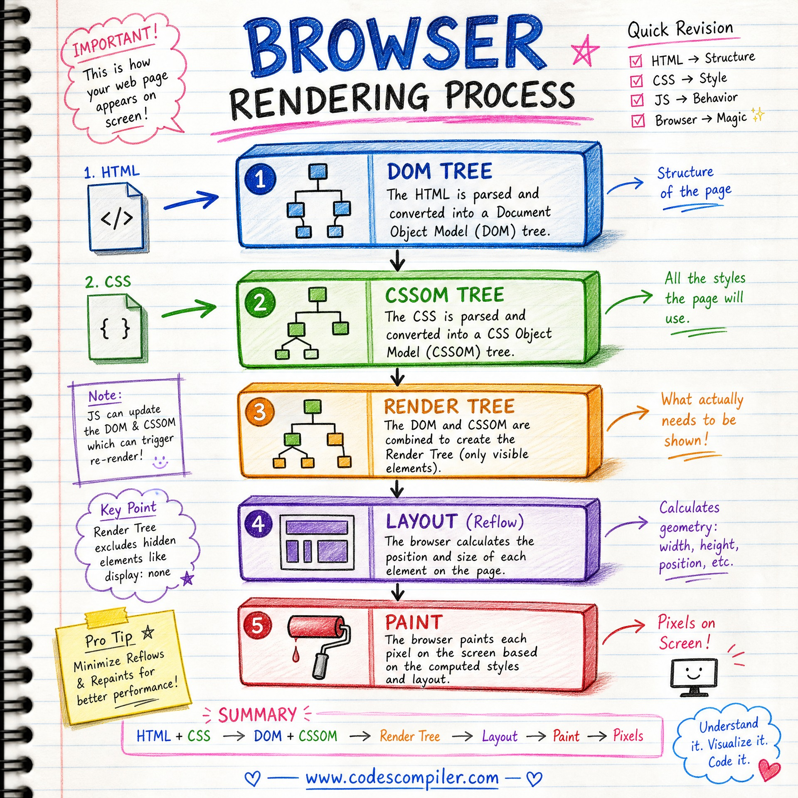
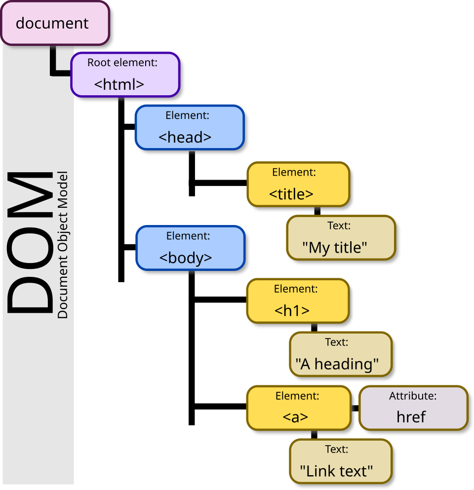

# Browser Essentials

### 1. **What HTML Really Is?**
* **The Common Misconception**: Many developers assume that saving a file with a `.html` extension and writing tags like `<h1>` or `
` directly tells the computer hardware to display text on screen. But HTML has no direct control over hardware memory, processors, or screen LEDs**. On its own, HTML is not a self-contained execution runtime.

* **C++ Engine Abstraction**: Basically HTML acts as a high-level parser/abstraction layer. Low-level browser engines primarily written in **C++**. This read the parsed structure and render elements and paint pixels on the screen.

---

### 2. **Browser Architecture: The Browser as an Operating System**
Modern web browsers function like a full Operating Systems. Here is the list of functional components of a browser:

1. **Data Persistence Layer**: This manages persistent storage including cookies, localStorage and cached JavaScript files.
2. **User Interface (UI) Layer**: The topmost interface layer that users visually interact by displaying text, images, buttons and video controls.
3. **Browser Engine & Rendering Engine**: While browsers use different engine implementations like Chrome vs. Safari but their core architectural steps are mostly standardized.
   * **Rendering Engine**: This is responsible for interpreting HTML and CSS, layout mathematics, tree generation and painting pixels.
   * **JavaScript Engine**: Handles JavaScript compilation and execution (e.g., Google's V8 engine).
4. **Networking Layer**: This handles communications across networks to request and load HTML, CSS, images and other remote or local assets.
5. **Browser Timers & Web APIs**: Functions such as `setTimeout()` and `setInterval()` are not native to the core JavaScript language engine itself. They are APIs borrowed directly from the browser container or Node.js runtime.

  

---

### 3. **Step-by-Step HTML to DOM Rendering Pipeline**
The primary work of the browser is to display data and enable user interaction. To transform a raw HTML file into structural nodes, the rendering engine runs through a multi-step pipeline:

1. **Loading Raw Bytes**: The browser requests the file over the network or local storage and receives raw binary data.
2. **Character Encoding Conversion**: The raw bytes are decoded into a sequence of readable characters based on the specified encoding like **UTF-8**.
3. **Tokenization**: Then Lexical analyzer **tokenize** the full file into tags like `<html>`, `<body>`, `<h1>`, and `
`.
4. **Object Generation**: Each token is converted into an in-memory object containing parameters, attributes (such as `title`) and value data.
5. **Document Object Model (DOM) & NodeList Construction**:
   * Objects are linked hierarchically according to parent, child, and sibling relationships to form the **Document Object Model (DOM)** tree.
   * The tree produces a **NodeList** structure.
   * My experiment: Running `document.getElementsByName()` in a browser developer console returns a `NodeList` object rather than a raw array or plain HTML string. This shows the C++ engine's internal node transformation.

   

---

### 4. **CSS Parsing & CSSOM (CSS Object Model)**
* **CSS Pipeline**: CSS resources undergo the exact same progression as HTML: **Raw Bytes → Character Encoding → Tokenization → Objects → Relationship Links**.
* **CSSOM Generation**: The output of CSS parsing is the CSS Object Model (CSSOM) tree.
* **Parallel Processing**: When a browser parses HTML and encounters a CSS `<link>` tag, it processes the DOM and CSSOM concurrently and independently. Initially they have no idea or knowledge about each other.

---

### 5. **The Render Tree & Painting Phase**
1. **Render Tree Construction**: The browser engine merges the **DOM tree** and **CSSOM tree** together to generate the **Render Tree**.
2. **Layout & Real Estate Calculations**: The browser engine performs rmathematical calculations which evaluates screen real estate to compute exact element positions.
3. **Painting Phase**: The engine executes **Painting** which converts computed layouts into visual pixels displayed on the user screen.

---

### 6. **JavaScript Execution & Performance Bottlenecks**
* **Parser-Blocking JavaScript**: When the browser sees a `<script>` tag during DOM parsing it halts DOM construction immediately. Because JavaScript has the authority to manupulate both DOM elements and CSSOM styles. So the browser pauses rendering to run the script first.
* **CSSOM Blocking JavaScript**: If a script tag is reached while the CSSOM tree is still building, JavaScript execution is paused until CSSOM construction finishes. That's why CSS processing can become a major execution bottleneck.
* **Asynchronous Execution (`async` / `defer`)**: Script attributes such as `async` allow scripts to download in the background without halting DOM parsing which improves page load performance.

---
### 7. **References**
[A useful Blog about browser](https://developer.chrome.com/blog/inside-browser-part3)

[Reference Video](https://youtu.be/5rLFYtXHo9s?si=x92NOyNiUVwAuj1h)