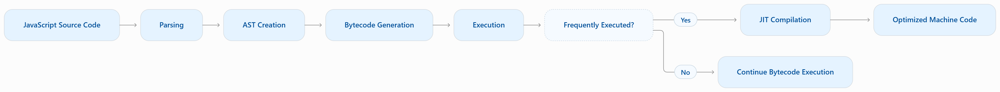
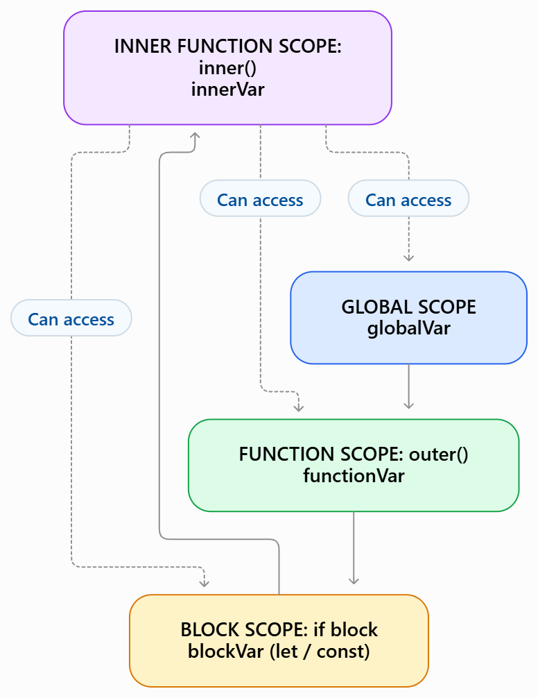

# JavaScript Notes From Scratch

## Day 3 — JavaScript Essentials

# 1. JavaScript Basics

## 1.1 What Is JavaScript?

JavaScript (JS) is a high-level programming language. It is used to make web pages interactive. It can also run on servers and in other environments.

Common uses include:

- Updating web page content.
- Responding to clicks and keyboard input.
- Validating forms.
- Sending and receiving data from servers.
- Building web servers and applications with environments such as Node.js.

JavaScript is:

- **Dynamically typed:** A variable can hold values of different types at different times.
- **Case-sensitive:** `userName` and `username` are different names.
- **Object-based:** Objects are a central part of the language.
- **Multi-paradigm:** It supports procedural, object-oriented, and functional styles.
- **Garbage-collected:** The JavaScript engine manages memory that is no longer needed.

JavaScript is standardized as **ECMAScript**. Browsers and other runtimes implement this language standard.

```js
let message = "Hello, JavaScript!";
console.log(message);

message = 100;
console.log(message); // The same variable can hold a number now.
```

## 1.2 How JavaScript Runs: Compilation and Interpretation

JavaScript is a high-level programming language. It uses both interpretation and compilation techniques.

Modern JavaScript engines use **Just-In-Time (JIT) Compilation** to improve performance.

For example:
- Chrome uses the V8 engine.
- Firefox uses SpiderMonkey.
- Safari uses JavaScriptCore.

### 1.2.1 How JavaScript Executes

The general execution process:

1. **Parsing:** Reads the code and checks its syntax.
2. **AST Creation:** Converts code into an Abstract Syntax Tree.
3. **Bytecode Generation:** Generates instructions for execution.
4. **Execution:** Executes the code.
5. **JIT Compilation:** Optimizes frequently executed code into machine code.



The exact process depends on the JavaScript engine.

### 1.2.2 Execution Context

An **Execution Context** is the environment where JavaScript code runs.

There are three types:

- **Global Execution Context:** Created when the program starts.
- **Function Execution Context:** Created whenever a function is called.
- **Eval Execution Context:** Created when `eval()` executes code.

An execution context has two phases:

1. **Creation Phase:** Allocates memory for variables and functions. `var` gets `undefined`, while `let` and `const` remain uninitialized.
2. **Execution Phase:** Executes code line by line and assigns values to variables.

```javascript
var a = 10;

function greet() {
    var b = 20;
    console.log(a + b);
}

greet(); // 30
```

### 1.2.3 Call Stack

The **Call Stack** manages function execution. It follows the LIFO (Last In, First Out) principle.

A function call is pushed onto the stack. It is removed when execution finishes.

```javascript
function first() {
    second();
    console.log("First");
}

function second() {
    console.log("Second");
}

first();
```

Output:
```text
Second
First
```

Infinite recursion can cause a **Stack Overflow** error.

### 1.2.4 Hoisting

**Hoisting** is JavaScript's behavior of processing declarations before code execution. It does not literally move code to the top.

- `var` is hoisted and initialized with `undefined`.
- `let` and `const` are hoisted but remain in the Temporal Dead Zone (TDZ) until initialized.
- Function declarations are fully hoisted.

```javascript
console.log(a); // undefined
var a = 10;

greet(); // Hello

function greet() {
    console.log("Hello");
}
```

Accessing `let` or `const` before initialization causes a `ReferenceError`.

### 1.2.5 Scope

**Scope** determines where variables can be accessed.

Main types:

1. **Global Scope:** Accessible throughout the relevant global scope.
2. **Function Scope:** Accessible only inside the function.
3. **Block Scope:** Accessible only inside `{ }`.
4. **Lexical Scope:** Inner functions can access variables from their outer scope.


```javascript
let name = "Rahman";

function outer() {
    let age = 22;

    function inner() {
        console.log(name);
        console.log(age);
    }

    inner();
}

outer();
```

Output:
```text
Rahman
22
```

**Note:** `var` is function-scoped, while `let` and `const` are block-scoped.

### 1.2.6 Closure

A **Closure** happens when an inner function remembers variables from its outer function, even after the outer function has finished executing.

```javascript
function counter() {
    let count = 0;

    return function() {
        count++;
        console.log(count);
    };
}

const increment = counter();

increment(); // 1
increment(); // 2
increment(); // 3
```

The inner function remembers the `count` variable.

**Uses of Closures:**
- Creating private variables.
- Maintaining data between function calls.
- Creating function factories.

## 1.3 Where Can JavaScript Run?

JavaScript runs inside a **JavaScript runtime environment**.

- **Browser:** Runs JavaScript in a web page. It provides browser features such as the DOM, `alert()`, and `fetch()`.
- **Node.js:** Runs JavaScript outside the browser. It provides features such as file-system and server APIs.

The language is JavaScript in both places, but the available runtime features can be different.

## 1.4 `console.log()`

`console.log()` prints a value to the console. It is commonly used to check output and debug code.

```js
console.log("Hello World");
console.log(25);
console.log(true);

const name = "Amina";
const age = 22;
console.log(name, age);
```

You can print the result of an expression too:

```js
console.log(10 + 5); // 15
console.log("Java" + "Script"); // JavaScript
```

## 1.5 Comments

Comments are notes for developers. JavaScript does not execute them.

```js
// This is a single-line comment.

/*
  This is a multi-line comment.
  It can cover several lines.
*/

console.log("Comments are ignored by the program.");
```

# 2. Variables: `var`, `let`, and `const`

A variable stores a value. JavaScript has three main variable declaration keywords: `var`, `let`, and `const`.

```js
var oldName = "Rahim";
let age = 21;
const country = "Bangladesh";

console.log(oldName, age, country);
```

> The correct keyword is `const`, not `cons`.

## 2.1 `var`

- `var` is function-scoped, not block-scoped.
- It can be declared again in the same scope.
- Its value can be reassigned.
- It is hoisted and initialized with `undefined`.

```js
var score = 10;
var score = 20; // Redeclaration is allowed.
score = 30;     // Reassignment is allowed.

console.log(score); // 30

if (true) {
  var city = "Dhaka";
}

console.log(city); // Dhaka: var is not limited to the block.
```

## 2.2 `let`

- `let` is block-scoped.
- It cannot be declared again in the same scope.
- Its value can be reassigned.
- It is hoisted, but it cannot be accessed before its declaration is executed.

```js
let count = 1;
count = 2; // Reassignment is allowed.

if (true) {
  let blockMessage = "Inside the block";
  console.log(blockMessage);
}

// console.log(blockMessage); // ReferenceError: outside its block.
```

## 2.3 `const`

- `const` is block-scoped.
- It cannot be declared again in the same scope.
- It cannot be reassigned.
- It must receive a value when it is declared.
- It is hoisted, but it cannot be accessed before its declaration is executed.

```js
const appName = "My App";
console.log(appName);

// appName = "New App"; // TypeError: reassignment is not allowed.
// const user;           // SyntaxError: an initial value is required.
```

A `const` object or array can still be changed internally. Only the variable's reference cannot be reassigned.

```js
const user = { name: "Amina" };
user.name = "Nadia"; // Allowed: the object is changed.

const numbers = [1, 2];
numbers.push(3); // Allowed: the array is changed.

console.log(user.name); // Nadia
console.log(numbers);   // [1, 2, 3]

// user = {}; // TypeError: cannot assign a new object to this const variable.
```

## 2.4 Difference Between `var`, `let`, and `const`

| Feature | `var` | `let` | `const` |
|---|---|---|---|
| Scope | Function or global | Block | Block |
| Redeclaration in the same scope | Yes | No | No |
| Reassignment | Yes | Yes | No |
| Must have an initial value | No | No | Yes |
| Hoisted | Yes; initialized as `undefined` | Yes; in the temporal dead zone until declaration | Yes; in the temporal dead zone until declaration |

**Hoisting** means declarations are processed before the code in their scope runs. It does not mean that a variable can always be safely used before its declaration.

```js
console.log(first); // undefined
var first = 10;

// console.log(second); // ReferenceError: temporal dead zone
let second = 20;
```

**Best practice:** Use `const` by default. Use `let` when you need to reassign a variable. Avoid `var` in modern JavaScript code unless you have a specific reason to use it.

# 3. Data Types in JavaScript

A data type describes the kind of value stored in a variable.

JavaScript has two broad categories:

1. **Primitive types:** Simple values that are not objects.
2. **Non-primitive types:** Objects, including arrays and functions.

## 3.1 Primitive Data Types

JavaScript has seven primitive types.

### 1. Number

`Number` represents integers and decimal numbers. It also includes special values such as `NaN` and `Infinity`.

```js
let age = 22;
let price = 99.5;
let result = 10 / 0;

console.log(age);    // 22
console.log(price);  // 99.5
console.log(result); // Infinity
console.log("hello" * 2); // NaN
```

Most ordinary numbers use the floating-point `Number` type. Very large or precise integer calculations may need `BigInt`.

### 2. String

A `String` stores text. Strings can use single quotes, double quotes, or backticks.

```js
let firstName = "Amina";
let country = 'Bangladesh';
let greeting = `Hello, ${firstName}!`;

console.log(firstName);
console.log(country);
console.log(greeting);
```

### 3. Boolean

A `Boolean` has only two possible values: `true` and `false`.

```js
let isLoggedIn = true;
let hasPermission = false;

console.log(isLoggedIn);   // true
console.log(10 > 5);       // true
console.log(hasPermission); // false
```

### 4. Undefined

`undefined` usually means a variable has been declared but has not been assigned a value.

```js
let address;

console.log(address);        // undefined
console.log(typeof address); // "undefined"
```

### 5. Null

`null` represents an intentional absence of a value.

```js
let selectedUser = null;

console.log(selectedUser);        // null
console.log(typeof selectedUser); // "object" (a historical JavaScript quirk)
```

`null` and `undefined` are different values. Use `null` when you intentionally want to represent “no value”.

### 6. BigInt

`BigInt` represents integers larger than the safe range of the `Number` type.

Add `n` at the end of an integer literal to create a `BigInt`.

```js
const largeNumber = 123456789012345678901234567890n;
const anotherNumber = 20n;

console.log(largeNumber + anotherNumber);
console.log(typeof largeNumber); // "bigint"
```

Do not mix `BigInt` and `Number` directly in arithmetic operations.

```js
// console.log(10n + 5); // TypeError
console.log(10n + BigInt(5)); // 15n
```

### 7. Symbol

A `Symbol` creates a unique value. Symbols are often used as unique object property keys.

```js
const id1 = Symbol("id");
const id2 = Symbol("id");

console.log(id1 === id2); // false: every Symbol is unique.
console.log(typeof id1);  // "symbol"
```

## 3.2 Non-Primitive Data Types

Objects store collections of properties. Arrays and functions are also objects in JavaScript.

```js
const person = {
  name: "Amina",
  age: 22
};

const colors = ["red", "green", "blue"];

function greet() {
  console.log("Hello!");
}

console.log(person.name); // Amina
console.log(colors[0]);   // red
console.log(typeof person); // object
console.log(typeof colors); // object
console.log(typeof greet);  // function
```

## 3.3 Checking a Data Type with `typeof`

The `typeof` operator returns a string describing a value's type.

```js
console.log(typeof 25);           // "number"
console.log(typeof "Hello");     // "string"
console.log(typeof true);         // "boolean"
console.log(typeof undefined);    // "undefined"
console.log(typeof 10n);           // "bigint"
console.log(typeof Symbol("id")); // "symbol"
console.log(typeof {});            // "object"
console.log(typeof null);          // "object" (historical quirk)
```

To check whether a value is an array, use `Array.isArray()`.

```js
const items = ["pen", "book"];
console.log(Array.isArray(items)); // true
```

## 3.4 Type Conversion

Type conversion changes a value from one type to another.

**Explicit conversion** is done by the developer.

```js
const value = "25";

console.log(Number(value)); // 25
console.log(String(100));   // "100"
console.log(Boolean(1));    // true
console.log(parseInt("42px", 10)); // 42
console.log(parseFloat("3.14"));   // 3.14
```

**Implicit conversion** happens automatically in some operations.

```js
console.log("5" + 2); // "52": + joins strings when a string is involved.
console.log("5" - 2); // 3: subtraction converts the string to a number.
console.log(true + 1); // 2: true is converted to 1.
```

Be careful with implicit conversion. Use explicit conversion when it makes the code clearer.

## 3.5 Truthy and Falsy Values

JavaScript converts values to Boolean in conditions. Some values are **falsy**, while most other values are **truthy**.

The main falsy values are:

- `false`
- `0` and `-0`
- `0n`
- `""` (empty string)
- `null`
- `undefined`
- `NaN`

```js
console.log(Boolean(0));        // false
console.log(Boolean(""));      // false
console.log(Boolean(null));     // false
console.log(Boolean("hello")); // true
console.log(Boolean([]));       // true
console.log(Boolean({}));       // true
```

Empty arrays and empty objects are truthy in JavaScript.

# 4. Operators in JavaScript

Operators perform actions on values and variables.

## 4.1 Arithmetic Operators

Arithmetic operators perform mathematical calculations.

| Operator | Meaning | Example | Result |
|---|---|---|---|
| `+` | Addition | `10 + 5` | `15` |
| `-` | Subtraction | `10 - 5` | `5` |
| `*` | Multiplication | `10 * 5` | `50` |
| `/` | Division | `10 / 5` | `2` |
| `%` | Remainder | `10 % 3` | `1` |
| `**` | Exponentiation | `2 ** 3` | `8` |
| `++` | Increment by 1 | `count++` | Adds 1 |
| `--` | Decrement by 1 | `count--` | Subtracts 1 |

```js
let a = 10;
let b = 3;

console.log(a + b);  // 13
console.log(a - b);  // 7
console.log(a * b);  // 30
console.log(a / b);  // 3.333...
console.log(a % b);  // 1
console.log(a ** b); // 1000

a++;
console.log(a); // 11
```

`++` and `--` can be used before or after a variable. Prefix changes the value before the expression is evaluated. Postfix uses the old value in the expression, then changes the variable.

```js
let x = 5;
console.log(x++); // 5, then x becomes 6

let y = 5;
console.log(++y); // y becomes 6, then prints 6
```

## 4.2 Assignment Operators

Assignment operators assign values to variables. Compound assignment operators combine an operation with assignment.

| Operator | Example | Same as |
|---|---|---|
| `=` | `x = 10` | Assign 10 to `x` |
| `+=` | `x += 5` | `x = x + 5` |
| `-=` | `x -= 5` | `x = x - 5` |
| `*=` | `x *= 5` | `x = x * 5` |
| `/=` | `x /= 5` | `x = x / 5` |
| `%=` | `x %= 3` | `x = x % 3` |
| `**=` | `x **= 2` | `x = x ** 2` |

```js
let total = 10;

total += 5;
console.log(total); // 15

total *= 2;
console.log(total); // 30

total -= 10;
console.log(total); // 20
```

## 4.3 Comparison Operators

Comparison operators compare two values. They return a Boolean: `true` or `false`.

| Operator | Meaning |
|---|---|
| `==` | Equal after type conversion if needed |
| `===` | Strictly equal: same value and same type |
| `!=` | Not equal after type conversion if needed |
| `!==` | Strictly not equal |
| `>` | Greater than |
| `<` | Less than |
| `>=` | Greater than or equal to |
| `<=` | Less than or equal to |

```js
console.log(5 == "5");  // true: values are converted for comparison.
console.log(5 === "5"); // false: types are different.
console.log(5 != "6");  // true
console.log(5 !== "5"); // true
console.log(10 > 5);    // true
console.log(10 <= 10);   // true
```

**Best practice:** Use `===` and `!==` in most cases. They avoid unexpected type conversion.

## 4.4 Logical Operators

Logical operators combine or reverse conditions.

| Operator | Meaning | Example |
|---|---|---|
| `&&` | AND: all conditions must be truthy | `age >= 18 && hasID` |
| `\|\|` | OR: at least one condition must be truthy | `isAdmin \|\| isOwner` |
| `!` | NOT: reverses truthiness | `!isLoggedIn` |

```js
const age = 22;
const hasID = true;

console.log(age >= 18 && hasID); // true
console.log(age < 18 || hasID);  // true
console.log(!hasID);             // false
```

Logical operators use short-circuit evaluation. For example, `&&` stops when the left side is falsy, and `||` stops when the left side is truthy.

## 4.5 Other Useful Operators

```js
// Ternary operator: a short form of if...else.
const age = 20;
const status = age >= 18 ? "Adult" : "Minor";
console.log(status); // Adult

// Nullish coalescing: use the right value only for null or undefined.
const userName = null;
console.log(userName ?? "Guest"); // Guest

// typeof: checks the type of a value.
console.log(typeof "JavaScript"); // string
```

# 5. Conditional Statements and Branching

Conditional statements run different blocks of code based on a condition.

## 5.1 `if`

The `if` statement runs a block when its condition is truthy.

```js
const age = 20;

if (age >= 18) {
  console.log("You are an adult.");
}
```

## 5.2 `if...else`

Use `else` to run another block when the condition is falsy.

```js
const number = 7;

if (number % 2 === 0) {
  console.log("Even number");
} else {
  console.log("Odd number");
}
```

## 5.3 `if...else if...else`

Use `else if` to check multiple conditions in order. The first matching block runs.

```js
const marks = 82;

if (marks >= 80) {
  console.log("Grade A+");
} else if (marks >= 70) {
  console.log("Grade A");
} else if (marks >= 60) {
  console.log("Grade B");
} else {
  console.log("Needs improvement");
}
```

## 5.4 `switch`

A `switch` statement compares one expression with several possible cases. Use `break` to prevent execution from continuing into the next case.

```js
const day = 2;

switch (day) {
  case 1:
    console.log("Sunday");
    break;
  case 2:
    console.log("Monday");
    break;
  case 3:
    console.log("Tuesday");
    break;
  default:
    console.log("Unknown day");
}
```

## 5.5 Ternary Operator

The ternary operator is useful for a short conditional expression.

```js
const age = 16;
const result = age >= 18 ? "Allowed" : "Not allowed";

console.log(result); // Not allowed
```

Use `if...else` when the logic is complex. It is easier to read.

# 6. Loops in JavaScript

Loops repeat a block of code. They are useful when working with repeated tasks or collections of data.

## 6.1 `for` Loop

A `for` loop is useful when you know how many times you want to repeat an action.

It has three main parts:

1. Initialization: runs once at the beginning.
2. Condition: checked before each iteration.
3. Update: runs after each iteration.

```js
for (let i = 1; i <= 5; i++) {
  console.log(i);
}
// Output: 1 2 3 4 5
```

## 6.2 `while` Loop

A `while` loop repeats while its condition is truthy. The condition is checked before the loop body.

```js
let i = 1;

while (i <= 5) {
  console.log(i);
  i++;
}
```

Make sure the condition can eventually become falsy. Otherwise, you may create an infinite loop.

## 6.3 `do...while` Loop

A `do...while` loop checks its condition after running the loop body. Therefore, it always runs at least once.

```js
let i = 1;

do {
  console.log(i);
  i++;
} while (i <= 5);
```

## 6.4 `for...of` Loop

A `for...of` loop reads the values from an iterable, such as an array or string.

```js
const fruits = ["Apple", "Mango", "Banana"];

for (const fruit of fruits) {
  console.log(fruit);
}
```

It is a good choice when you need the values of an array.

## 6.5 `for...in` Loop

A `for...in` loop goes through the enumerable property keys of an object.

```js
const student = {
  name: "Amina",
  age: 22,
  department: "CSE"
};

for (const key in student) {
  console.log(key, student[key]);
}
```

For arrays, `for...in` gives index keys. Prefer `for...of` when you want array values.

## 6.6 `break` and `continue`

- `break` stops the loop immediately.
- `continue` skips the current iteration and moves to the next one.

```js
for (let i = 1; i <= 5; i++) {
  if (i === 3) {
    continue; // Skip 3.
  }
  console.log(i); // 1, 2, 4, 5
}

for (let i = 1; i <= 5; i++) {
  if (i === 4) {
    break; // Stop when i is 4.
  }
  console.log(i); // 1, 2, 3
}
```

# 7. Strings in JavaScript

A string is a sequence of characters used to store text. Strings are **immutable**, which means string methods do not change the original string. They return a new string or another value.

## 7.1 Creating Strings

Strings can be created with single quotes, double quotes, or backticks.

```js
const first = 'Hello';
const second = "World";
const third = `JavaScript`;

console.log(first, second, third);
```

Backticks create a **template literal**. They support string interpolation and multi-line strings.

## 7.2 String Indexing and Length

Each character has an index. String indexes start at `0`.

```js
const language = "JavaScript";

console.log(language[0]); // J
console.log(language[1]); // a
console.log(language[4]); // S
console.log(language.length); // 10
console.log(language[language.length - 1]); // t
```

An index outside the string returns `undefined` when using bracket notation.

```js
console.log(language[50]); // undefined
```

## 7.3 String Interpolation

String interpolation inserts variables or expressions into a template literal using `${}`.

```js
const name = "Amina";
const age = 22;

console.log(`My name is ${name} and I am ${age} years old.`);
console.log(`Next year, I will be ${age + 1}.`);
```

## 7.4 Common String Methods

### `toUpperCase()`

Converts a string to uppercase.

```js
const text = "hello world";
console.log(text.toUpperCase()); // HELLO WORLD
```

### `toLowerCase()`

Converts a string to lowercase.

```js
const text = "HELLO WORLD";
console.log(text.toLowerCase()); // hello world
```

### `trim()`

Removes whitespace from the beginning and end of a string. It does not remove spaces between words.

```js
const text = "   hello world   ";
console.log(text.trim()); // "hello world"
```

### `concat()`

Joins strings and returns a new string. The `+` operator or template literals are often easier to read.

```js
const firstName = "Amina";
const lastName = "Rahman";

console.log(firstName.concat(" ", lastName)); // Amina Rahman
console.log(`${firstName} ${lastName}`);      // Amina Rahman
```

### `replace()`

Replaces the first matching text and returns a new string. It does not change the original string.

```js
const text = "I like Java. Java is popular.";

console.log(text.replace("Java", "JavaScript"));
// I like JavaScript. Java is popular.
```

To replace every matching occurrence, use `replaceAll()`.

```js
console.log(text.replaceAll("Java", "JS"));
// I like JS. JS is popular.
```

### `charAt()`

Returns the character at a given index. It returns an empty string if the index is outside the string.

```js
const word = "JavaScript";

console.log(word.charAt(0)); // J
console.log(word.charAt(4)); // S
console.log(word.charAt(50)); // ""
```

### More Useful String Methods

```js
const text = "JavaScript is powerful";

console.log(text.includes("powerful")); // true
console.log(text.startsWith("Java"));   // true
console.log(text.endsWith("ful"));      // true
console.log(text.slice(0, 10));         // JavaScript
console.log(text.split(" "));           // ["JavaScript", "is", "powerful"]
```

# 8. Arrays in JavaScript

An array stores multiple values in a single variable. An array can contain values of different types.

## 8.1 Creating Arrays

Use square brackets `[]` to create an array.

```js
const fruits = ["Apple", "Mango", "Banana"];
const numbers = [10, 20, 30, 40];
const mixed = [10, "Hello", true, null];

console.log(fruits);
console.log(numbers);
console.log(mixed);
```

## 8.2 Array Indexing and Length

Array indexes start at `0`. Use `length` to get the number of elements.

```js
const fruits = ["Apple", "Mango", "Banana"];

console.log(fruits[0]); // Apple
console.log(fruits[1]); // Mango
console.log(fruits[2]); // Banana
console.log(fruits.length); // 3
console.log(fruits[fruits.length - 1]); // Banana
```

You can update an element by assigning a new value to its index.

```js
const colors = ["red", "green", "blue"];
colors[1] = "yellow";

console.log(colors); // ["red", "yellow", "blue"]
```

## 8.3 Looping Over an Array

### Using a `for` Loop

```js
const fruits = ["Apple", "Mango", "Banana"];

for (let i = 0; i < fruits.length; i++) {
  console.log(fruits[i]);
}
```

### Using a `for...of` Loop

```js
const fruits = ["Apple", "Mango", "Banana"];

for (const fruit of fruits) {
  console.log(fruit);
}
```

### Using `forEach()`

`forEach()` runs a callback function once for each array element. It does not create a new array.

```js
const numbers = [10, 20, 30];

numbers.forEach((number, index) => {
  console.log(index, number);
});
```

# 9. Common Array Methods

Array methods can add, remove, search, or copy elements. Some methods change the original array, while others return a new array.

## 9.1 `push()`

Adds one or more elements to the end of an array. It returns the new array length and changes the original array.

```js
const fruits = ["Apple", "Mango"];

const newLength = fruits.push("Banana");
console.log(fruits);    // ["Apple", "Mango", "Banana"]
console.log(newLength); // 3
```

## 9.2 `pop()`

Removes the last element and returns the removed element. It changes the original array.

```js
const fruits = ["Apple", "Mango", "Banana"];

const removedFruit = fruits.pop();
console.log(removedFruit); // Banana
console.log(fruits);       // ["Apple", "Mango"]
```

## 9.3 `unshift()`

Adds one or more elements to the beginning of an array. It returns the new array length and changes the original array.

```js
const fruits = ["Mango", "Banana"];

const newLength = fruits.unshift("Apple");
console.log(fruits);    // ["Apple", "Mango", "Banana"]
console.log(newLength); // 3
```

## 9.4 `shift()`

Removes the first element and returns the removed element. It changes the original array.

```js
const fruits = ["Apple", "Mango", "Banana"];

const removedFruit = fruits.shift();
console.log(removedFruit); // Apple
console.log(fruits);       // ["Mango", "Banana"]
```

## 9.5 `toString()`

Converts an array into a comma-separated string.

```js
const fruits = ["Apple", "Mango", "Banana"];

console.log(fruits.toString()); // Apple,Mango,Banana
```

## 9.6 `concat()`

Joins two or more arrays and returns a new array. It does not change the original arrays.

```js
const first = [1, 2, 3];
const second = [4, 5, 6];

const combined = first.concat(second);
console.log(combined); // [1, 2, 3, 4, 5, 6]
console.log(first);    // [1, 2, 3]
```

## 9.7 `slice()`

Returns a shallow copy of part of an array. It does not change the original array.

Syntax: `array.slice(start, end)`

- `start` is the first index to include.
- `end` is the index before which to stop. The end index is not included.

```js
const numbers = [10, 20, 30, 40, 50];

console.log(numbers.slice(1, 4)); // [20, 30, 40]
console.log(numbers.slice(2));    // [30, 40, 50]
console.log(numbers);             // Original array is unchanged.
```

## 9.8 `splice()`

`splice()` adds, removes, or replaces elements in the original array. It returns an array containing the removed elements.

Syntax: `array.splice(start, deleteCount, item1, item2, ...)`

```js
const fruits = ["Apple", "Mango", "Banana", "Orange"];

const removed = fruits.splice(1, 2);

console.log(removed); // ["Mango", "Banana"]
console.log(fruits);  // ["Apple", "Orange"]
```

It can also insert or replace elements.

```js
const colors = ["red", "blue"];

colors.splice(1, 0, "green");
console.log(colors); // ["red", "green", "blue"]

colors.splice(0, 1, "black");
console.log(colors); // ["black", "green", "blue"]
```

**Remember the difference:** `slice()` copies part of an array and does not modify it. `splice()` changes the original array.

## 9.9 More Useful Array Methods

These methods are common in everyday JavaScript code.

### `includes()` and `indexOf()`

```js
const fruits = ["Apple", "Mango", "Banana"];

console.log(fruits.includes("Mango")); // true
console.log(fruits.indexOf("Banana")); // 2
console.log(fruits.indexOf("Orange")); // -1: not found
```

### `join()`

Joins array elements into a string using a separator.

```js
const words = ["Learn", "JavaScript", "step", "by", "step"];
console.log(words.join(" ")); // Learn JavaScript step by step
```

### `map()`

Creates a new array by transforming each element.

```js
const numbers = [1, 2, 3];
const doubled = numbers.map((number) => number * 2);

console.log(doubled); // [2, 4, 6]
console.log(numbers); // [1, 2, 3]: original is unchanged.
```

### `filter()`

Creates a new array containing elements that pass a condition.

```js
const numbers = [1, 2, 3, 4, 5, 6];
const evenNumbers = numbers.filter((number) => number % 2 === 0);

console.log(evenNumbers); // [2, 4, 6]
```

### `find()`

Returns the first element that passes a condition. It returns `undefined` if no element matches.

```js
const numbers = [5, 12, 8, 20];
const found = numbers.find((number) => number > 10);

console.log(found); // 12
```

### `reduce()`

Reduces an array to a single value by running a callback for each element.

```js
const numbers = [10, 20, 30];

const sum = numbers.reduce((total, number) => total + number, 0);
console.log(sum); // 60
```

# 10. Functions in JavaScript

A function is a reusable block of code. It runs when we call it. Functions help us avoid repeating code.

## 10.1 Function Definition and Function Call

A **function definition** creates a function. A **function call** runs that function.

```js
// Function definition
function greet() {
  console.log("Hello, JavaScript!");
}

// Function call
greet();
```

## 10.2 Parameters and Arguments

**Parameters** are variables in a function definition. **Arguments** are the values we pass when calling the function.

```js
function greet(name) { // name is a parameter
  console.log(`Hello, ${name}!`);
}

greet("Amina"); // "Amina" is an argument
```

A function can accept more than one parameter.

```js
function add(a, b) {
  console.log(a + b);
}

add(10, 20); // 30
```

## 10.3 The `return` Statement

`return` sends a value back to the place where the function was called. It also stops the function.

```js
function multiply(a, b) {
  return a * b;
}

const result = multiply(4, 5);
console.log(result); // 20
```

A function returns `undefined` when it has no `return` statement.

```js
function showMessage() {
  console.log("Welcome!");
}

const value = showMessage();
console.log(value); // undefined
```

## 10.4 Default Parameters

A default parameter provides a value when an argument is missing or is `undefined`.

```js
function greet(name = "Guest") {
  console.log(`Hello, ${name}!`);
}

greet("Rafi"); // Hello, Rafi!
greet();        // Hello, Guest!
```

## 10.5 Function Expressions

A function expression stores a function in a variable. The function can be anonymous.

```js
const subtract = function (a, b) {
  return a - b;
};

console.log(subtract(9, 4)); // 5
```

A function expression cannot be called before its variable is initialized.

## 10.6 Arrow Functions

An arrow function is a shorter way to write a function expression. It uses the `=>` symbol.

```js
const add = (a, b) => {
  return a + b;
};

console.log(add(3, 7)); // 10
```

For a single expression, we can use an implicit return.

```js
const square = number => number * number;

console.log(square(5)); // 25
```

Use parentheses for zero or multiple parameters.

```js
const sayHello = () => console.log("Hello!");
const divide = (a, b) => a / b;
```

### Arrow Function vs. Normal Function

| Normal function | Arrow function |
|---|---|
| Uses the `function` keyword. | Uses the `=>` symbol. |
| Has its own `this`, based on how it is called. | Does not create its own `this`. It uses `this` from the surrounding scope. |
| Has its own `arguments` object. | Does not have its own `arguments` object. |
| Can be used as a constructor with `new`. | Cannot be used as a constructor. |
| Can be hoisted when written as a function declaration. | A variable holding an arrow function follows the variable's hoisting rules. |

Use normal methods when an object method needs its own `this`. Arrow functions are useful for short callbacks.

```js
const user = {
  name: "Amina",
  greet() {
    console.log(`Hello, ${this.name}`);
  }
};

user.greet(); // Hello, Amina
```

## 10.7 Callback Functions

A callback is a function passed to another function as an argument. The receiving function can call it later.

```js
function processUser(name, callback) {
  console.log(`Processing ${name}`);
  callback();
}

function finish() {
  console.log("Done!");
}

processUser("Amina", finish);
```

An arrow function can also be used as a callback.

```js
setTimeout(() => {
  console.log("This runs after one second.");
}, 1000);
```

## 10.8 `forEach()` on Arrays

`forEach()` runs a callback once for each array element. It is useful when we want to perform an action for every item. It does not create a new array.

### Using an Arrow Function

```js
const numbers = [10, 20, 30];

numbers.forEach((number) => {
  console.log(number);
});
```

### Using a Normal Function Expression

```js
const numbers = [10, 20, 30];

numbers.forEach(function (number) {
  console.log(number);
});
```

### Passing a Separately Defined Function

```js
const numbers = [10, 20, 30];

function printNumber(number) {
  console.log(number);
}

numbers.forEach(printNumber);
```

The callback can receive three arguments: the current element, its index, and the original array.

```js
const fruits = ["Apple", "Mango", "Banana"];

fruits.forEach((fruit, index, array) => {
  console.log(index, fruit, array);
});
```

## 10.9 Important Array Methods: `map()`, `filter()`, and `reduce()`

These methods accept callback functions. They do not change the original array when used in the examples below.

### `map()`

`map()` creates a new array. It transforms every element.

```js
const numbers = [1, 2, 3, 4];
const doubled = numbers.map(number => number * 2);

console.log(doubled); // [2, 4, 6, 8]
console.log(numbers); // [1, 2, 3, 4]
```

### `filter()`

`filter()` creates a new array with elements that pass a condition.

```js
const numbers = [1, 2, 3, 4, 5, 6];
const evenNumbers = numbers.filter(number => number % 2 === 0);

console.log(evenNumbers); // [2, 4, 6]
```

### `reduce()`

`reduce()` processes the array and returns one final value. The accumulator stores the result from each step.

```js
const numbers = [10, 20, 30];

const total = numbers.reduce((sum, number) => {
  return sum + number;
}, 0); // 0 is the initial value

console.log(total); // 60
```

### Quick Comparison

| Method | Main purpose | Return value |
|---|---|---|
| `forEach()` | Perform an action for each item. | `undefined` |
| `map()` | Transform each item. | A new array |
| `filter()` | Keep items that pass a test. | A new array |
| `reduce()` | Combine items into one result. | A single value |

## 10.10 Rest Parameters

Rest parameters collect multiple arguments into an array. Write `...` before the parameter name.

```js
function sum(...numbers) {
  return numbers.reduce((total, number) => total + number, 0);
}

console.log(sum(1, 2, 3, 4)); // 10
```

## 10.11 Scope

Scope controls where a variable can be accessed.

- **Global scope:** A variable declared outside functions and blocks.
- **Function scope:** A variable declared with `var` inside a function.
- **Block scope:** A variable declared with `let` or `const` inside `{ }`.

```js
const siteName = "My Website"; // Global scope

function showUser() {
  const userName = "Amina"; // Function scope
  console.log(siteName);
  console.log(userName);
}

showUser();
// console.log(userName); // ReferenceError
```

`let` and `const` are block-scoped. `var` is function-scoped.

```js
if (true) {
  let message = "Inside the block";
  var count = 10;
}

// console.log(message); // ReferenceError
console.log(count); // 10
```

## 10.12 Closure

A closure happens when an inner function remembers variables from its outer function. It can use those variables even after the outer function has finished.

```js
function createCounter() {
  let count = 0;

  return function () {
    count++;
    return count;
  };
}

const counter = createCounter();
console.log(counter()); // 1
console.log(counter()); // 2
```

## 10.13 Recursion

Recursion happens when a function calls itself. It must have a stopping condition, called a base case.

```js
function countdown(number) {
  if (number <= 0) return; // Base case

  console.log(number);
  countdown(number - 1);
}

countdown(3); // 3, 2, 1
```

---

# 11. DOM (Document Object Model)

## 11.1 What Is the DOM?

DOM means **Document Object Model**. The browser creates the DOM from an HTML document. It represents the page as a tree of objects called nodes.

JavaScript can use the DOM to read and change HTML elements, attributes, styles, and content.

```js
// The document object represents the current HTML page.
console.log(document);
```

## 11.2 Starter HTML Code: `<style>` and `<script>`

HTML creates the page structure. The `<style>` tag contains CSS. The `<script>` tag loads or contains JavaScript.

```html
<!DOCTYPE html>
<html lang="en">
<head>
  <meta charset="UTF-8">
  <meta name="viewport" content="width=device-width, initial-scale=1.0">
  <title>DOM Practice</title>

  <style>
    body {
      font-family: Arial, sans-serif;
    }

    .highlight {
      color: blue;
    }
  </style>

  <script src="script.js" defer></script>
</head>
<body>
  <h1 id="heading">Hello, DOM!</h1>
  <p class="message">Learning JavaScript.</p>
</body>
</html>
```

The `defer` attribute tells the browser to run the external script after the HTML has been parsed. It also keeps the script from blocking HTML parsing.

JavaScript can also be written directly inside a `<script>` tag.

```html
<script>
  console.log("JavaScript is running!");
</script>
```

For larger projects, it is common to keep CSS and JavaScript in separate files.

## 11.3 The `window` Object

`window` is the main global object in a browser window. It provides browser features such as timers, dialogs, and the current page location. The `document` object is available through `window`.

```js
console.log(window);
console.log(window.document);
console.log(window.location.href);

// These are also available without writing window.
console.log(document);
console.log(location.href);
```

`window` is a browser object. It is not available in the same way in a normal Node.js environment.

## 11.4 Selecting HTML Elements

JavaScript provides several methods to select elements from the DOM.

### Selecting by ID: `getElementById()`

An ID should be unique on a page. Do not include `#` in this method.

```html
<h1 id="title">Welcome</h1>
```

```js
const title = document.getElementById("title");
console.log(title);
```

### Selecting by Class: `getElementsByClassName()`

This method returns a live `HTMLCollection` of matching elements.

```html
<p class="info">First paragraph</p>
<p class="info">Second paragraph</p>
```

```js
const infoItems = document.getElementsByClassName("info");
console.log(infoItems);
console.log(infoItems[0]);
```

### Selecting by Tag: `getElementsByTagName()`

This method returns a live `HTMLCollection` of elements with the given tag name.

```js
const paragraphs = document.getElementsByTagName("p");
console.log(paragraphs);
```

### Selecting with `querySelector()`

`querySelector()` returns the first element that matches a CSS selector. Use `#` for an ID and `.` for a class.

```js
const title = document.querySelector("#title");
const firstInfo = document.querySelector(".info");
const firstParagraph = document.querySelector("p");
```

### Selecting with `querySelectorAll()`

`querySelectorAll()` returns a static `NodeList` of all matching elements.

```js
const allInfo = document.querySelectorAll(".info");

allInfo.forEach(item => {
  console.log(item.textContent);
});
```

## 11.5 Common DOM Properties

Assume this HTML:

```html
<div id="box">
  <h2>Hello</h2>
  <p>Learn <strong>JavaScript</strong>.</p>
</div>
```

Select the element first.

```js
const box = document.getElementById("box");
```

### `tagName`

Returns the tag name of an element. HTML tag names are usually returned in uppercase.

```js
console.log(box.tagName); // DIV
```

### `innerText`

Gets or sets the text that is rendered on the page. It considers styling and layout.

```js
console.log(box.innerText);
box.innerText = "New text";
```

### `textContent`

Gets or sets all text inside an element. It does not depend on whether the text is visible on the page.

```js
console.log(box.textContent);
box.textContent = "Plain text only";
```

### `innerHTML`

Gets or sets the HTML markup inside an element. The browser parses the assigned HTML.

```js
box.innerHTML = "<h2>New heading</h2><p>New paragraph</p>";
console.log(box.innerHTML);
```

**Important:** Do not put untrusted user input into `innerHTML`. It can create a cross-site scripting (XSS) security risk. Use `textContent` when you only need to insert text.

## 11.6 Working with Attributes

Attributes provide extra information about HTML elements. Use these methods to read, add, update, or remove attributes.

```html

```

```js
const photo = document.getElementById("photo");

console.log(photo.getAttribute("src"));

photo.setAttribute("src", "new.jpg");
photo.setAttribute("width", "300");

console.log(photo.hasAttribute("alt")); // true
photo.removeAttribute("alt");
```

For custom data attributes, use the `dataset` property.

```html
<button id="saveButton" data-user-id="25">Save</button>
```

```js
const button = document.getElementById("saveButton");
console.log(button.dataset.userId); // "25"
```

## 11.7 Changing Styles and Classes

The `style` property changes an element's inline CSS. Use camelCase for CSS properties with hyphens.

```js
const title = document.querySelector("h1");

title.style.color = "red";
title.style.backgroundColor = "yellow";
title.style.fontSize = "30px";
```

`classList` is useful for adding and removing CSS classes.

```js
title.classList.add("highlight");
title.classList.remove("highlight");
title.classList.toggle("highlight");

console.log(title.classList.contains("highlight"));
```

## 11.8 Creating and Inserting Elements

Use `createElement()` to create a new element. Use methods such as `append()` or `prepend()` to insert it.

```html
<ul id="list">
  <li>Apple</li>
</ul>
```

```js
const list = document.getElementById("list");

const newItem = document.createElement("li");
newItem.textContent = "Mango";

list.append(newItem);  // Adds at the end
list.prepend(newItem); // Adds at the beginning
```

Other useful insertion methods include `before()`, `after()`, and `appendChild()`.

```js
const anotherItem = document.createElement("li");
anotherItem.textContent = "Banana";

newItem.after(anotherItem);
```

## 11.9 Deleting Elements

Use `remove()` to remove an element from the DOM.

```js
const item = document.querySelector("li");
item.remove();
```

You can also remove a child through its parent.

```js
const list = document.getElementById("list");
const firstItem = list.firstElementChild;

list.removeChild(firstItem);
```

## 11.10 DOM Traversal

DOM traversal means moving between related elements in the DOM tree.

```js
const item = document.querySelector("li");

console.log(item.parentElement);
console.log(item.children);
console.log(item.nextElementSibling);
console.log(item.previousElementSibling);
console.log(item.closest("ul"));
```

## 11.11 DOM Events

An event is an action that happens in the browser. Examples include clicks, typing, and form submission. Use `addEventListener()` to respond to an event.

```html
<button id="clickButton">Click me</button>
<p id="result"></p>
```

```js
const clickButton = document.getElementById("clickButton");
const result = document.getElementById("result");

clickButton.addEventListener("click", () => {
  result.textContent = "Button clicked!";
});
```

The event object contains information about the event.

```js
clickButton.addEventListener("click", (event) => {
  console.log(event.type);   // click
  console.log(event.target); // The clicked element
});
```

Use `preventDefault()` to stop a browser's default action, such as a form submission or link navigation.

```js
const form = document.querySelector("form");

form.addEventListener("submit", (event) => {
  event.preventDefault();
  console.log("Form handled with JavaScript.");
});
```

## 11.12 Event Bubbling and Delegation

Many events bubble from a child element up through its parent elements. Event delegation uses this behavior. It lets one parent handle events from its children.

```js
const list = document.querySelector("ul");

list.addEventListener("click", (event) => {
  if (event.target.matches("li")) {
    console.log("Clicked:", event.target.textContent);
  }
});
```

This is useful when list items are added or removed dynamically.

---

# 12. Objects, Prototypes, and Classes

## 12.1 Objects in JavaScript

An object stores data as **key-value pairs**. A key is also called a property name. An object can also contain functions, called methods.

```js
const student = {
  name: "Amina",
  age: 22,
  isEnrolled: true
};

console.log(student);
```

## 12.2 Accessing Object Properties

Use dot notation or bracket notation to read a property.

```js
const student = {
  name: "Amina",
  age: 22
};

console.log(student.name);      // Dot notation
console.log(student["age"]);   // Bracket notation
```

Bracket notation is useful when the key is stored in a variable or contains spaces.

```js
const key = "name";
console.log(student[key]); // Amina
```

## 12.3 Adding, Updating, and Deleting Properties

```js
const student = {
  name: "Amina",
  age: 22
};

student.city = "Dhaka"; // Add
student.age = 23;        // Update
delete student.city;     // Delete

console.log(student);
```

## 12.4 Nested Objects

An object can contain another object.

```js
const user = {
  name: "Rafi",
  address: {
    city: "Dhaka",
    country: "Bangladesh"
  }
};

console.log(user.address.city); // Dhaka
```

Optional chaining (`?.`) safely accesses a property that may not exist. It returns `undefined` instead of throwing an error when the value before `?.` is `null` or `undefined`.

```js
console.log(user.contact?.email); // undefined
```

## 12.5 Object Methods and the `this` Keyword

A function stored in an object is called a method. Inside a normal method call, `this` usually refers to the object before the dot.

```js
const user = {
  name: "Amina",
  greet() {
    console.log(`Hello, I am ${this.name}.`);
  }
};

user.greet(); // Hello, I am Amina.
```

An arrow function does not create its own `this`. Avoid using an arrow function as an object method when you need `this` to refer to that object.

## 12.6 Useful Object Methods

JavaScript provides methods to inspect an object's own properties.

```js
const student = {
  name: "Amina",
  age: 22
};

console.log(Object.keys(student));   // ["name", "age"]
console.log(Object.values(student)); // ["Amina", 22]
console.log(Object.entries(student));
```

`Object.entries()` returns an array of key-value pairs. We can loop over it.

```js
for (const [key, value] of Object.entries(student)) {
  console.log(key, value);
}
```

## 12.7 Object Destructuring

Destructuring extracts properties into variables.

```js
const student = {
  name: "Amina",
  age: 22
};

const { name, age } = student;
console.log(name, age);
```

We can rename a variable while destructuring.

```js
const { name: studentName } = student;
console.log(studentName); // Amina
```

## 12.8 Spread Syntax with Objects

Spread syntax (`...`) copies enumerable properties into a new object. It creates a shallow copy.

```js
const original = { name: "Amina", age: 22 };
const copy = { ...original, city: "Dhaka" };

console.log(copy);
```

A shallow copy does not deeply copy nested objects.

## 12.9 Prototypes in JavaScript

Every ordinary JavaScript object has an internal prototype link. That link points to another object or to `null`. This forms the **prototype chain**.

When JavaScript cannot find a property on an object, it looks up the prototype chain.

```js
const animal = {
  eat() {
    console.log("The animal is eating.");
  }
};

const dog = Object.create(animal);
dog.bark = function () {
  console.log("Woof!");
};

dog.bark(); // Woof!
dog.eat();  // The animal is eating.
```

The `dog` object does not have its own `eat` method. It finds that method through its prototype.

Use `Object.getPrototypeOf()` to inspect an object's prototype.

```js
console.log(Object.getPrototypeOf(dog) === animal); // true
console.log(Object.hasOwn(dog, "bark")); // true
console.log(Object.hasOwn(dog, "eat"));  // false
```

## 12.10 Constructor Functions and Prototypes

Before ES6 classes, constructor functions were commonly used to create similar objects. The `new` keyword creates an object and connects it to the constructor's `prototype`.

```js
function Person(name) {
  this.name = name;
}

Person.prototype.greet = function () {
  console.log(`Hello, ${this.name}`);
};

const person1 = new Person("Amina");
person1.greet(); // Hello, Amina
```

## 12.11 Classes in JavaScript

A class is a template for creating objects. It groups data and methods in one structure. JavaScript classes use prototypes behind the scenes.

### Class Structure and Object Creation

Use the `class` keyword to define a class. Use `new` to create an object, also called an instance.

```js
class Person {
  greet() {
    console.log("Hello!");
  }
}

const person1 = new Person();
person1.greet(); // Hello!
```

### Constructor and `this`

The `constructor()` method runs when a new object is created. Use `this` to set or access the current object's properties.

```js
class Student {
  constructor(name, age) {
    this.name = name;
    this.age = age;
  }

  introduce() {
    console.log(`I am ${this.name} and I am ${this.age}.`);
  }
}

const student1 = new Student("Amina", 22);
student1.introduce();
```

A class can have only one constructor method. If no constructor is written, JavaScript provides a default constructor.

### Methods

Methods define actions that an object can perform. They are shared through the class prototype.

```js
class Calculator {
  add(a, b) {
    return a + b;
  }
}

const calculator = new Calculator();
console.log(calculator.add(5, 3)); // 8
```

## 12.12 Inheritance and the `extends` Keyword

Inheritance allows one class to use properties and methods from another class. The child class uses `extends` to inherit from the parent class.

```js
class Animal {
  eat() {
    console.log("Eating...");
  }
}

class Dog extends Animal {
  bark() {
    console.log("Woof!");
  }
}

const dog = new Dog();
dog.eat();  // Inherited from Animal
dog.bark(); // Defined in Dog
```

## 12.13 The `super` Keyword

`super` is used to call the parent class constructor or access parent class methods. A child class must call `super()` before using `this` when it defines its own constructor.

```js
class Animal {
  constructor(name) {
    this.name = name;
  }

  speak() {
    console.log(`${this.name} makes a sound.`);
  }
}

class Dog extends Animal {
  constructor(name, breed) {
    super(name); // Calls the parent constructor
    this.breed = breed;
  }

  speak() {
    super.speak(); // Calls the parent method
    console.log(`${this.name} barks.`);
  }
}

const dog = new Dog("Tommy", "Labrador");
dog.speak();
```

## 12.14 Static Methods

A static method belongs to the class itself. You call it using the class name, not an instance.

```js
class MathHelper {
  static double(number) {
    return number * 2;
  }
}

console.log(MathHelper.double(5)); // 10
```

## 12.15 Getters and Setters

A getter reads a value like a property. A setter runs when we assign a value to that property.

```js
class Temperature {
  constructor(celsius) {
    this.celsius = celsius;
  }

  get fahrenheit() {
    return (this.celsius * 9) / 5 + 32;
  }

  set fahrenheit(value) {
    this.celsius = ((value - 32) * 5) / 9;
  }
}

const temp = new Temperature(0);
console.log(temp.fahrenheit); // 32

temp.fahrenheit = 68;
console.log(temp.celsius); // 20
```

## 12.16 Private Class Fields

A private field starts with `#`. It can only be accessed inside its class.

```js
class BankAccount {
  #balance = 0;

  deposit(amount) {
    this.#balance += amount;
  }

  getBalance() {
    return this.#balance;
  }
}

const account = new BankAccount();
account.deposit(500);
console.log(account.getBalance()); // 500
// console.log(account.#balance); // SyntaxError outside the class
```

## 12.17 The `instanceof` Operator

`instanceof` checks whether a constructor's prototype appears in an object's prototype chain.

```js
class Person {}
const person = new Person();

console.log(person instanceof Person); // true
console.log(person instanceof Object); // true
```

---

# 13. Error Handling

Errors can stop normal program execution. JavaScript provides `try`, `catch`, `finally`, and `throw` to handle errors.

## 13.1 `try...catch`

Put code that may fail inside `try`. If an error occurs, JavaScript runs the `catch` block.

```js
try {
  const result = JSON.parse("{ invalid JSON }");
  console.log(result);
} catch (error) {
  console.log("Something went wrong:", error.message);
}
```

## 13.2 The `finally` Block

`finally` runs after `try` and `catch`. It runs whether an error happens or not.

```js
try {
  console.log("Working...");
} catch (error) {
  console.log(error.message);
} finally {
  console.log("This always runs.");
}
```

## 13.3 Throwing Errors

Use `throw` to create an error when a condition is not valid. `Error` creates an error object with a useful message.

```js
function withdraw(balance, amount) {
  if (amount > balance) {
    throw new Error("Insufficient balance");
  }

  return balance - amount;
}

try {
  console.log(withdraw(100, 150));
} catch (error) {
  console.log(error.message); // Insufficient balance
}
```

## 13.4 Error Handling Best Practices

- Catch errors when you can handle them or provide useful information.
- Use clear error messages.
- Do not silently ignore important errors.
- Use `finally` for cleanup work that must happen in either case.
- Do not use `try...catch` as a replacement for normal condition checks.