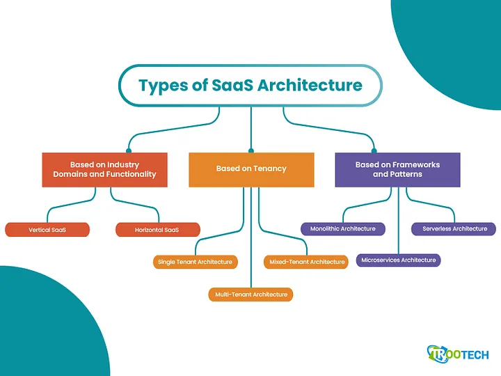
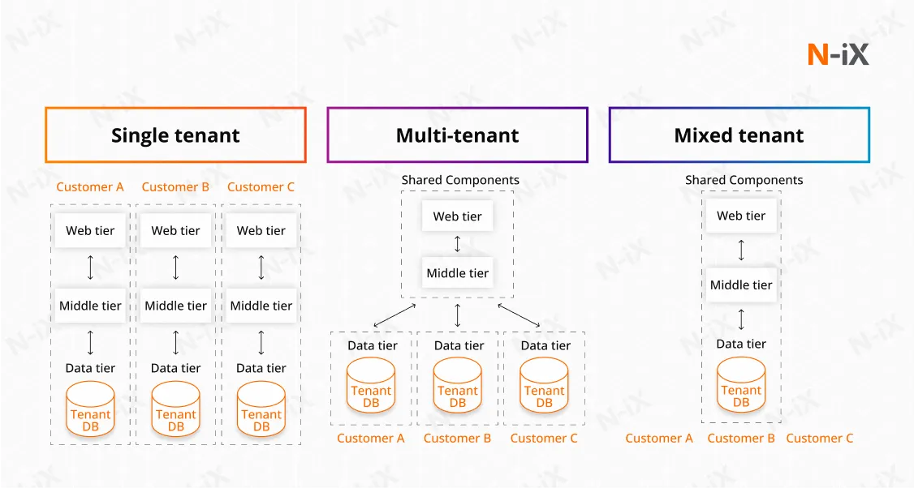

# Software-as-a-Service or SaaS
Here is a reference [SaaS Architecture Blog](https://medium.com/latest-trends-in-industries-by-trootech/decoding-saas-architecture-a-comprehensive-guide-076a069e47e2)  
Another useful [SaaS Architecture Blog](https://www.n-ix.com/saas-architecture/)

The SaaS Architecture can be devided by 3 ways. These are: 

   

## 1. SaaS Architectures — Based on Industry Domains and Functionality
### 1.1 Vertical SaaS
It provide customized solutions for different requirements. It caters to business domains, including real estate, healthcare, retail, manufacturing, agriculture, finance, logistics and more.

### 1.2 Horizontal SaaS
it focuses on a broad spectrum of audiences with general-purpose applications. Horizontal SaaS offers a much wider range of functionalities, such as customer relationship management, project management, team collaboration, and more efficiently serving common business requirements, regardless of the industry type. 

### Comparison

| Feature       | Vertical SaaS                           | Horizontal SaaS                          |
| ------------- | --------------------------------------- | ---------------------------------------- |
| Target Market | Specific industry                       | Multiple industries                      |
| Functionality | Industry-specific                       | General-purpose                          |
| Customization | Focused on industry requirements        | Adaptable to different businesses        |
| Examples      | Hospital, School, Restaurant Management | Project Management, CRM, Email Marketing |

## 2. SaaS Architectures — Based on Tenancy
The tenancy model is based on component shareability, where customers pay a subscription fee for using SaaS applications and their access rights.

Tenant is basically an individual or legal entity who rents or leases property such as an apartment, house, land, or commercial space—from a landlord in exchange for regular rent payments. Under a lease or rental agreement, the tenant gains the legal right to occupy and use the space for a set period without owning it. In Saas architecture a tenant works the same, where where customers pay a subscription fee for using SaaS applications and their access rights.

   

### 2.1 Single tenant architecture
Here each customer has a dedicated instance of the software and database. This model offers enhanced security, as data is isolated from other customers and allows for greater customization. Enterprise-level customers typically choose single-tenant architectures to fulfill specific security, compliance or performance needs. However, this model can be more expensive due to the need for separate resources for each tenant.

### 2.2 Multi-tenant architecture
The multi-tenant architecture allows multiple customers to share a single software instance and its underlying infrastructure. Each tenant's data is logically separated to ensure security, but the system operates on shared resources. This highly scalable and cost-effective model makes it a popular choice for SaaS providers serving customers with similar needs. Multi-tenancy also enables easier upgrades and maintenance, as all tenants roll out updates simultaneously.

### 2.3 Mixed-tenant architecture
A mixed-tenant architecture blends elements of both single-tenant and multi-tenant models. Specific resources, such as the application layer, might be shared, while others, like the database, are kept separate for each tenant. This hybrid approach balances the scalability benefits of multi-tenancy with the security and customization advantages of single tenancy. Mixed tenancy is often used in SaaS solutions that cater to SMBs and large enterprises.

## 3 SaaS Architectures — Based on frameworks and patterns
1. Monolithic architecture involves building the entire SaaS application as a single, unified codebase, making it easier to develop but harder to scale as it grows.
2. Serverless architecture allows developers to focus on building applications without managing infrastructure, offering automatic scaling for fluctuating workloads but challenges in managing complex logic.
3. Microservices architecture divides applications into independent services, enabling separate development, deployment, and scaling, which is ideal for large-scale SaaS platforms.
4. Event-driven architecture uses asynchronous communication through events, making it suitable for real-time data processing in SaaS products like financial services or IoT platforms.
5. The layered architecture separates the application into distinct layers—presentation, application, and data—promoting modularity and easier updates.
6. Service-oriented architecture (SOA) builds applications around loosely coupled services, useful for integrating legacy systems or external services in SaaS applications.
7. Distributed architecture spreads components across multiple servers or locations, improving scalability, fault tolerance, and performance for large-scale SaaS platforms.
8. Containerized architecture packages the application and its dependencies into containers, allowing for rapid scaling and consistent deployment with minimal downtime.